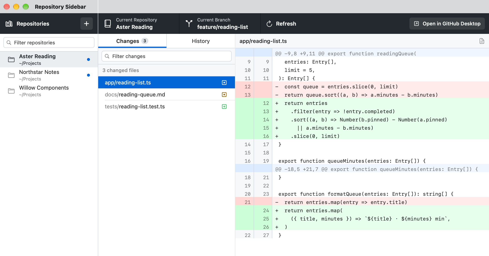

# Repository Sidebar

Repository Sidebar is a native macOS app for reviewing local Git changes. It keeps your repositories visible in a permanent sidebar while you browse changed files, commit history, and diffs.



## What you can do

- Open repositories already registered in GitHub Desktop, or add local Git folders with **+**.
- Find recent work first. The sidebar ranks repositories by local commit timestamps and uncommitted file changes.
- Review local changes and the current branch’s 40 most recent commits with a unified diff and old and new line numbers.
- Use **Open in GitHub Desktop** when you want to commit, switch branches, or sync.

## Build and run

The app runs on macOS 14 or later. To build it, use Xcode 16 or later with its command-line tools selected.

```sh
git clone https://github.com/bosstwobread/repository-sidebar.git
cd repository-sidebar
./build.sh
open 'build/Repository Sidebar.app'
```

The build produces an ad hoc signed app for Apple Silicon and Intel Macs.

## Keyboard shortcuts

| Shortcut | Action |
| --- | --- |
| **← / →** | Move focus between the repository sidebar and the active Changes or History list |
| **↑ / ↓** | Move selection in the focused list |
| **⌘1 / ⌘2** | Open Changes or History |
| **⌘O** | Add local repositories |
| **⌘R** | Refresh the repository list and local changes |

The focused selection is blue. Each pane keeps its selected item when you move focus or click an empty area.

## Local data

Repository Sidebar reads GitHub Desktop 3.7’s local repository registry and uses system Git to inspect your working copies. You can add folders manually if GitHub Desktop is unavailable. macOS may ask for permission to read repositories in protected folders such as Documents or Desktop.
